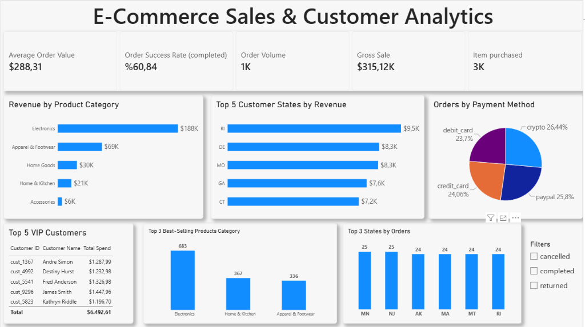
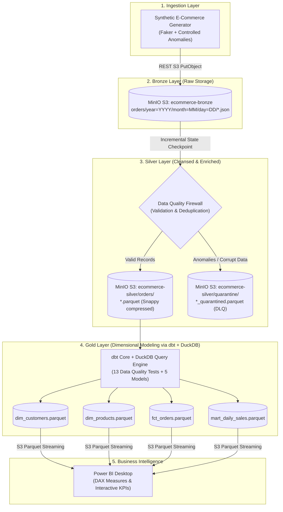

# 🛍️ End-to-End E-Commerce Medallion Lakehouse Pipeline

[](https://airflow.apache.org/)
[](https://www.getdbt.com/)
[](https://min.io/)
[](https://powerbi.microsoft.com/)
[](https://duckdb.org/)
[](https://www.docker.com/)

A modern, production-grade **Data Lakehouse** pipeline implementing the **Medallion Architecture (Bronze -> Silver -> Gold)**. Built with **MinIO (S3 Object Storage)**, **Apache Parquet**, **DuckDB**, **dbt**, and **Apache Airflow 2.x (TaskFlow API)**, culminating in a live **Power BI Executive Dashboard**.

---

## 📊 Executive Sales & Customer Analytics Dashboard

Directly powered by the Lakehouse Gold Layer (`s3://ecommerce-gold/*.parquet`) via HTTP S3 streaming in Power BI:



---

## 🏗️ High-Level Architecture

The pipeline follows modern **ELT (Extract-Load-Transform)** principles, decoupling cloud-native storage from analytical compute:



---

## 🌟 Key Engineering Highlights & Resilience Design

### 1. Medallion Storage Pattern
* **Bronze (`Raw`):** Immutable, append-only raw JSON transaction batches with Hive-style partitioning (`year=YYYY/month=MM/day=DD`).
* **Silver (`Cleaned`):** Flattened nested JSON structures into granular order line-items stored in high-performance **Snappy Parquet** format.
* **Gold (`Curated Marts`):** Star Schema dimensional models (`dim_customers`, `dim_products`, `fct_orders`, `mart_daily_sales`) modeled via **dbt** and materialized using **DuckDB**.

### 2. Data Quality Firewall & Dead Letter Queue (DLQ)
Real-world systems receive unexpected anomalies. The generator intentionally injects ~8% corrupt records (negative order totals, null customer keys, invalid status strings):
* **Routing:** Clean records pass to `ecommerce-silver/orders/`. Anomalous records are automatically isolated into `ecommerce-silver/quarantine/` with a detailed `rejection_reason` audit tag.
* **Zero Disruption:** Corrupt transactions never break analytical models or downstream reports.

### 3. End-to-End Incremental & Idempotent Processing
* **Bronze -> Silver:** Implements an S3-based state checkpoint file (`_metadata/processed_files.json`) calculating set deltas (`all_files - processed_files`). Only unread JSON files are transformed.
* **Row-Level Idempotency:** Duplicate records are pruned via composite key deduplication (`order_id`, `product_id`).
* **Gold Modeling:** Customer profiles are strictly deduplicated using SQL Window Functions (`ROW_NUMBER() OVER (PARTITION BY customer_id ORDER BY order_timestamp DESC)`) ensuring exact primary key uniqueness.

### 4. Airflow Resilience & Smart Retry Policies
* **Exponential Backoff:** Configured with `retries=3`, `retry_delay=30s`, `retry_exponential_backoff=True` to withstand transient network spikes.
* **Permanent Failure Callback:** If retries are exhausted, `on_failure_callback` captures execution metadata, error stack traces, and appends a critical alert banner to `/opt/airflow/logs/pipeline_failures.log`.

---

## 📐 Data Modeling (Star Schema)

The analytical Gold layer is organized into a Star Schema optimized for OLAP aggregations:

```
                  ┌───────────────────────────────┐
                  │         dim_customers         │
                  ├───────────────────────────────┤
                  │ PK  customer_id               │
                  │     customer_name             │
                  │     customer_city             │
                  │     customer_state            │
                  │     total_orders_placed       │
                  │     lifetime_spend            │
                  └───────────────┬───────────────┘
                                  │ 1
                                  │
                                  │ N
┌─────────────────────────┐  N    │   1  ┌─────────────────────────┐
│       dim_products      ├───────┼──────┤        fct_orders       │
├─────────────────────────┤       │      ├─────────────────────────┤
│ PK  product_id          │       │      │ PK    order_id          │
│     product_name        │       │      │ FK    customer_id       │
│     product_category    │       │      │ FK    product_id        │
│     current_unit_price  │       └──────┤       quantity          │
│     total_units_sold    │              │       unit_price        │
│     total_revenue_generated            │       line_item_total   │
└─────────────────────────┘              │       shipping_fee      │
                                         │       tax_amount        │
                                         │       order_total_amount│
                                         │       order_timestamp   │
                                         │       payment_method    │
                                         │       order_status      │
                                         └─────────────────────────┘
```

---

## 🛠️ Tech Stack & Trade-Offs

| Technology | Role | Why Chosen? |
| :--- | :--- | :--- |
| **MinIO** | S3 Object Storage | 100% AWS S3 API compatible, lightweight, high performance, zero cloud billing for local development. |
| **Apache Parquet** | Storage Format | Columnar format with Snappy compression; reduces storage footprint by ~80% and drastically accelerates OLAP scans. |
| **DuckDB** | In-Process SQL Engine | Serverless, lightning-fast C++ OLAP engine. Capable of reading/writing remote S3 Parquet files without heavy Spark clusters. |
| **dbt Core** | Transformation | Declarative SQL modeling, version control, automated lineage, and 13 automated data quality tests. |
| **Apache Airflow 2.x** | Orchestrator | Industry-standard DAG scheduling, TaskFlow API (`@dag`, `@task`), retry policies, and monitoring. |
| **Power BI Desktop** | Visualization | Direct S3 Parquet streaming consumption, Star Schema modeling, and interactive DAX calculations. |
| **Docker Compose** | Infrastructure | Fully containerized environment ensuring single-command reproducibility. |

---

## 🚀 Quickstart Guide

### Prerequisites
* [Docker Desktop](https://www.docker.com/products/docker-desktop/) installed and running.
* Python 3.10+ (optional, for local script testing).
* [Power BI Desktop](https://powerbi.microsoft.com/) (for opening `.pbix`).

### 1. Clone & Setup Environment
```bash
git clone https://github.com/FurkaannK/Ecommerce-Medallion-Lakehouse-Pipeline.git
cd Ecommerce-Medallion-Lakehouse-Pipeline

# Copy environment configuration
cp .env.example .env
```

### 2. Start the Lakehouse Platform
Launch MinIO, PostgreSQL, Airflow Webserver, Scheduler, and automated bucket provisioning:
```bash
docker compose up -d
```
* **MinIO Console:** [http://localhost:9001](http://localhost:9001) (`minioadmin` / `minioadminpassword`)
* **Airflow UI:** [http://localhost:8080](http://localhost:8080) (`admin` / `admin`)

### 3. Run the End-to-End Pipeline
1. Open the Airflow UI at `http://localhost:8080`.
2. Toggle the `ecommerce_medallion_lakehouse_pipeline` DAG to **Active**.
3. Click the **Trigger DAG (▶)** button.
4. Watch tasks execute in sequence:
   * `ingest_orders_to_bronze` ➔ `transform_and_quarantine_silver` ➔ `monitor_quarantine_metrics` & `dbt_build_gold_models_and_tests`.

### 4. Explore Power BI Report
Open `ecommerce-customer-analysis.pbix` in Power BI Desktop and click **Refresh** to stream live data directly from the local MinIO Gold bucket!

---

## 🧪 Testing & Data Quality

Run all 13 dbt data quality tests (and rebuild models) locally:
```bash
dbt build --project-dir dbt --profiles-dir dbt
```
Tests include:
* `not_null` & `unique` validation on all primary keys (`customer_id`, `product_id`).
* `not_null` validation on foreign keys & core measures (`order_id`, `customer_id`, `order_status`, `order_date`, `gross_sales`).
* `accepted_values` checks on order statuses (`completed`, `cancelled`, `returned`).
* Singular business logic assertion (`assert_positive_total_amount.sql`) ensuring no non-positive line items reach the Gold layer.

---

## 📂 Project Structure

```text
ecommerce-medallion-lakehouse-pipeline/
├── airflow/
│   └── dags/
│       └── ecommerce_lakehouse_dag.py     # Modern TaskFlow DAG with retry & alerts
├── config/
│   └── s3_config.py                       # Reusable Boto3 S3 singleton client
├── dbt/
│   ├── dbt_project.yml                    # dbt project configurations
│   ├── profiles.yml                       # DuckDB-to-MinIO S3 connection settings
│   ├── models/
│   │   ├── staging/                       # Silver views & parquet sources
│   │   │   ├── schema.yml
│   │   │   └── stg_orders.sql
│   │   └── gold/                          # Dimensional Marts (Star Schema)
│   │       ├── schema.yml                 # 13 Data quality test definitions
│   │       ├── dim_customers.sql
│   │       ├── dim_products.sql
│   │       ├── fct_orders.sql
│   │       └── mart_daily_sales.sql
│   └── tests/
│       └── assert_positive_total_amount.sql # Singular business test
├── docs/
│   └── images/
│       └── dashboard.png                  # Executive dashboard preview
├── src/
│   ├── ingestion/
│   │   └── generate_mock_orders.py        # Faker synthetic generator with anomalies
│   └── transformation/
│       └── bronze_to_silver.py            # Quality firewall, DLQ quarantine & deduplication
├── docker-compose.yml                     # Multi-container orchestration (MinIO, Airflow, Postgres)
├── Dockerfile                             # Custom Airflow image with Lakehouse dependencies
├── ecommerce-customer-analysis.pbix       # Power BI report file
├── requirements.txt                       # Local environment dependencies
└── README.md
```
